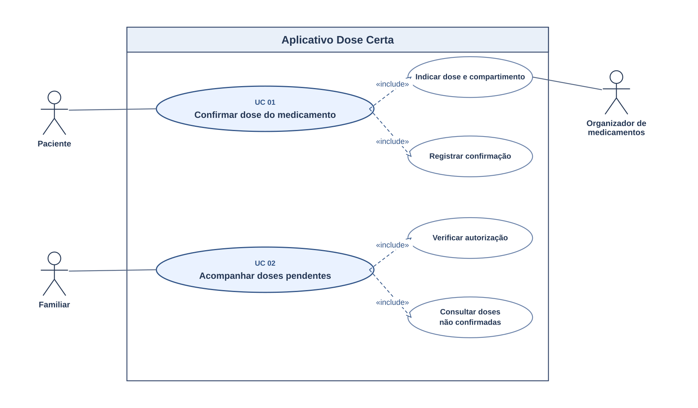
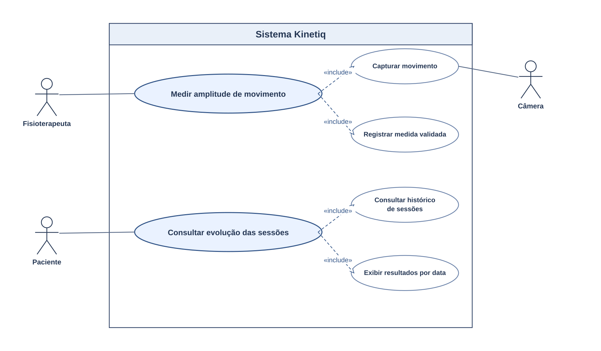

# Requisitos Ideathon INOVA SAÚDE 2026

As soluções escolhidas entre as dez apresentações finalistas foram **Dose Certa** (solução 03) e **Kinetiq** (solução 07). O documento de apresentação descreve as ideias em alto nível; os comportamentos detalhados abaixo são hipóteses de requisitos a validar com as equipes e os usuários.

## 1 Dose Certa

**Problema:** pessoas que tomam vários medicamentos podem esquecer doses e confundir horários.  
**Ideia apresentada:** um organizador de medicamentos conectado a um aplicativo avisa a hora da dose, ilumina o compartimento correspondente e alerta um familiar quando o paciente não confirma a tomada.

### Diagrama de casos de uso

No diagrama, **UC 01** e **UC 02** são os dois casos principais detalhados nesta atividade. As elipses menores representam funções obrigatórias de apoio, ligadas por relações UML **«include»** (seta do caso principal para a função incluída). **Paciente** e **Familiar** iniciam os respectivos casos; o **Organizador de medicamentos** participa da indicação da dose e do compartimento. As linhas contínuas representam associações com atores, não a ordem dos passos.

### UC 01 Confirmar dose do medicamento

**Ator principal:** Paciente.  
**Objetivo:** receber a indicação do medicamento devido e registrar que tomou aquela dose.

**Pré-condições:** o paciente tem acesso ao aplicativo; a dose, o horário e o compartimento correspondente foram cadastrados; o organizador está associado à conta.

**Gatilho:** chega o horário de uma dose programada.

**Fluxo principal:**

1. O sistema identifica a dose programada para aquele horário.
2. O aplicativo apresenta o nome do medicamento, a dose prevista e o horário; o organizador sinaliza o compartimento correspondente.
3. O paciente consulta a indicação e, após tomar o medicamento, seleciona **Confirmar dose** no aplicativo.
4. O sistema verifica se aquela dose ainda está aguardando confirmação.
5. O sistema registra a confirmação com data e horário e atualiza o histórico do paciente.
6. O aplicativo exibe a confirmação da operação e retira a dose da lista de pendências.

**Fluxos alternativos e exceções:**

- **A1 — Dose já confirmada:** no passo 4, o sistema informa que a confirmação já existe e não duplica o registro.
- **A2 — Organizador desconectado:** no passo 2, o aplicativo ainda mostra o lembrete e informa que não foi possível acionar a luz do compartimento; a falha de conexão não é tratada como confirmação da dose.
- **A3 — Paciente não confirma:** o caso termina sem registrar a tomada; após o prazo de tolerância, a dose passa a constar como não confirmada para o acompanhamento autorizado.

**Pós-condição:** a dose confirmada consta no histórico com data e horário; se não houve confirmação, o sistema não a apresenta como tomada.

**História de usuário:** Como paciente que usa vários medicamentos, quero confirmar cada dose no aplicativo, para acompanhar o que já tomei e evitar confusão entre os horários.

**Critérios de aceitação:**

1. Dado que uma dose cadastrada chegou ao horário previsto, quando o lembrete é disparado, então o aplicativo mostra o medicamento e o organizador ilumina o compartimento correspondente.
2. Dado que há uma dose aguardando confirmação, quando o paciente confirma a tomada, então o sistema registra a dose como tomada com data e horário e remove a pendência dessa dose.
3. Dado que uma dose já foi confirmada, quando o paciente tenta confirmá-la novamente, então o sistema informa que ela já foi registrada e não cria uma segunda confirmação.

### UC 02 Acompanhar doses pendentes

**Ator principal:** Familiar.  
**Objetivo:** verificar as doses não confirmadas pelo paciente e receber o alerta pertinente.

**Pré-condições:** o familiar está autenticado e autorizado pelo paciente a acompanhar as doses; existe uma programação de medicamentos cadastrada.

**Gatilho:** o familiar recebe um alerta ou abre a área de acompanhamento.

**Fluxo principal:**

1. O sistema verifica quais doses não foram confirmadas após o prazo de tolerância definido.
2. Para cada dose nessa situação, registra o estado **não confirmada** e disponibiliza um alerta ao familiar autorizado.
3. O familiar abre a área de acompanhamento do paciente.
4. O sistema valida a autorização de acesso e apresenta as doses não confirmadas com medicamento, horário previsto e situação atual.
5. O familiar consulta uma ocorrência para verificar seus detalhes e decidir se precisa entrar em contato com o paciente.

**Fluxos alternativos e exceções:**

- **A1 — Sem pendências:** no passo 4, o sistema informa que não há doses não confirmadas no período consultado.
- **A2 — Acesso não autorizado:** no passo 4, o sistema bloqueia a consulta e não revela dados sobre medicamentos ou horários.
- **A3 — Confirmação posterior:** se a dose for confirmada depois do alerta, o sistema atualiza sua situação; o histórico mantém os horários previstos e de confirmação para distinguir o atraso da falta de confirmação.

**Pós-condição:** o familiar acessa somente as informações autorizadas; a consulta não altera o registro de tomada do paciente.

**História de usuário:** Como familiar autorizado, quero acompanhar as doses não confirmadas, para verificar se o paciente precisa de ajuda com a rotina de medicamentos.

**Critérios de aceitação:**

1. Dado que o paciente não confirmou uma dose após o prazo de tolerância configurado, quando esse prazo termina, então o sistema marca a dose como pendente e envia um alerta ao familiar autorizado.
2. Dado que existe uma dose não confirmada, quando o familiar abre o acompanhamento, então o sistema mostra medicamento, horário previsto e situação, sem afirmar que a dose não foi ingerida.
3. Dado que uma pessoa não foi vinculada como familiar autorizado, quando tenta consultar as doses do paciente, então o sistema bloqueia o acesso às informações.

## 2 Kinetiq

**Problema:** a medição manual do movimento pode variar entre avaliadores, e o paciente não visualiza com facilidade o próprio progresso.  
**Ideia apresentada:** uma câmera com IA mede ângulos articulares, salva cada sessão e compara os resultados anteriores em um gráfico.

### Diagrama de casos de uso

No diagrama, **Medir amplitude de movimento** e **Consultar evolução das sessões** são os dois casos principais detalhados nesta atividade. As elipses menores representam funções obrigatórias de apoio, ligadas por relações UML **«include»** (seta do caso principal para a função incluída). **Fisioterapeuta** e **Paciente** iniciam os respectivos casos; a **Câmera** participa da captura do movimento. As linhas contínuas representam associações com atores, não a ordem dos passos.

### Medir amplitude de movimento

**Ator principal:** Fisioterapeuta.  
**Objetivo:** obter e registrar o ângulo de uma articulação em uma sessão de reabilitação.

**Pré-condições:** o fisioterapeuta está autenticado, selecionou o paciente e a articulação a avaliar, e a câmera está disponível.

**Gatilho:** o fisioterapeuta inicia uma medição durante a sessão.

**Fluxo principal:**

1. O sistema solicita o enquadramento do segmento corporal correspondente à articulação escolhida.
2. O fisioterapeuta posiciona o paciente e inicia a captura do movimento.
3. A câmera fornece as imagens e o sistema estima o ângulo articular por meio do processamento previsto na solução.
4. O sistema exibe o ângulo calculado, a articulação e a identificação da sessão para revisão.
5. O fisioterapeuta confere a medida e confirma o registro.
6. O sistema associa o valor ao paciente, à articulação, à data e à sessão e informa que o registro foi salvo.

**Fluxos alternativos e exceções:**

- **A1 — Enquadramento insuficiente:** no passo 3, o sistema solicita reposicionamento e não permite salvar o valor inconfiável como resultado da sessão.
- **A2 — Captura interrompida:** o sistema avisa que não foi possível concluir a medição e permite tentar novamente, sem criar resultado definitivo.
- **A3 — Medida rejeitada pelo profissional:** no passo 5, o fisioterapeuta descarta o resultado e reinicia a captura; o valor rejeitado não integra o histórico de evolução.

**Pós-condição:** uma medida confirmada pelo profissional fica registrada e disponível para comparação futura; tentativas descartadas não aparecem como resultados concluídos.

**História de usuário:** Como fisioterapeuta, quero medir e registrar a amplitude de movimento por câmera, para acompanhar as sessões do paciente de maneira consistente.

**Critérios de aceitação:**

1. Dado que o paciente e a articulação foram selecionados e a câmera está ativa, quando o fisioterapeuta inicia a medição, então o sistema apresenta o ângulo calculado e identifica a articulação avaliada.
2. Dado que a articulação está fora do enquadramento necessário, quando o sistema tenta medir o movimento, então ele solicita reposicionamento e não salva um valor inválido como resultado da sessão.
3. Dado que a medição foi apresentada, quando o fisioterapeuta confirma o resultado, então o sistema salva o valor associado ao paciente, à articulação e à data da sessão.

### Consultar evolução das sessões

**Ator principal:** Paciente.  
**Objetivo:** visualizar suas medições anteriores para acompanhar a evolução.

**Pré-condições:** o paciente está autenticado e tem acesso à área de evolução; a existência de medições será verificada na consulta.

**Gatilho:** o paciente abre a área de evolução e escolhe uma articulação.

**Fluxo principal:**

1. O sistema verifica se a conta solicitante é a titular dos dados consultados.
2. O sistema busca as medições confirmadas da articulação selecionada.
3. O sistema ordena as sessões por data e apresenta um gráfico com os ângulos medidos.
4. O paciente seleciona um ponto para consultar a data da sessão e o valor correspondente.
5. O paciente compara os resultados de sessões anteriores com os mais recentes.

**Fluxos alternativos e exceções:**

- **A1 — Uma única sessão:** no passo 3, o sistema mostra o único resultado disponível e explica que ainda não há dados suficientes para comparar a evolução.
- **A2 — Nenhuma sessão para a articulação:** o sistema informa que não há medições registradas para a seleção e não exibe um gráfico vazio como se fosse resultado clínico.
- **A3 — Dados de outro paciente:** no passo 1, o sistema nega o acesso e não apresenta informações de terceiros.

**Pós-condição:** o paciente visualiza apenas seus resultados registrados; a consulta não modifica as medições originais.

**História de usuário:** Como paciente em reabilitação, quero ver a evolução das minhas medições em um gráfico, para entender como meu movimento mudou entre as sessões.

**Critérios de aceitação:**

1. Dado que existem ao menos duas sessões registradas para a mesma articulação, quando o paciente abre a evolução, então o sistema exibe os ângulos por data em ordem cronológica no gráfico.
2. Dado que há somente uma sessão registrada, quando o paciente abre a evolução, então o sistema mostra a medição disponível e informa que ainda não há dados suficientes para comparar sessões.
3. Dado que o paciente tenta acessar dados de outra pessoa, quando solicita a evolução, então o sistema impede a consulta e não exibe medições de terceiros.

## Premissas para validação

- Dose Certa: a confirmação é feita pelo paciente e não comprova, por si só, a ingestão do medicamento; o prazo de tolerância e a autorização do familiar precisam ser definidos com a equipe.
- Kinetiq: o profissional confirma a medição antes do registro; enquadramento, precisão e condições de comparação devem ser definidos com a equipe. O gráfico informa evolução das medidas, sem emitir diagnóstico automaticamente.
- Os fluxos detalhados são uma proposta de elicitação baseada nas apresentações, não uma afirmação de que as equipes já implementaram todas as funções. Em especial, cadastro e vinculação de contas, tolerância de atraso, precisão da medição e tratamento de falhas precisam de validação com os responsáveis.
